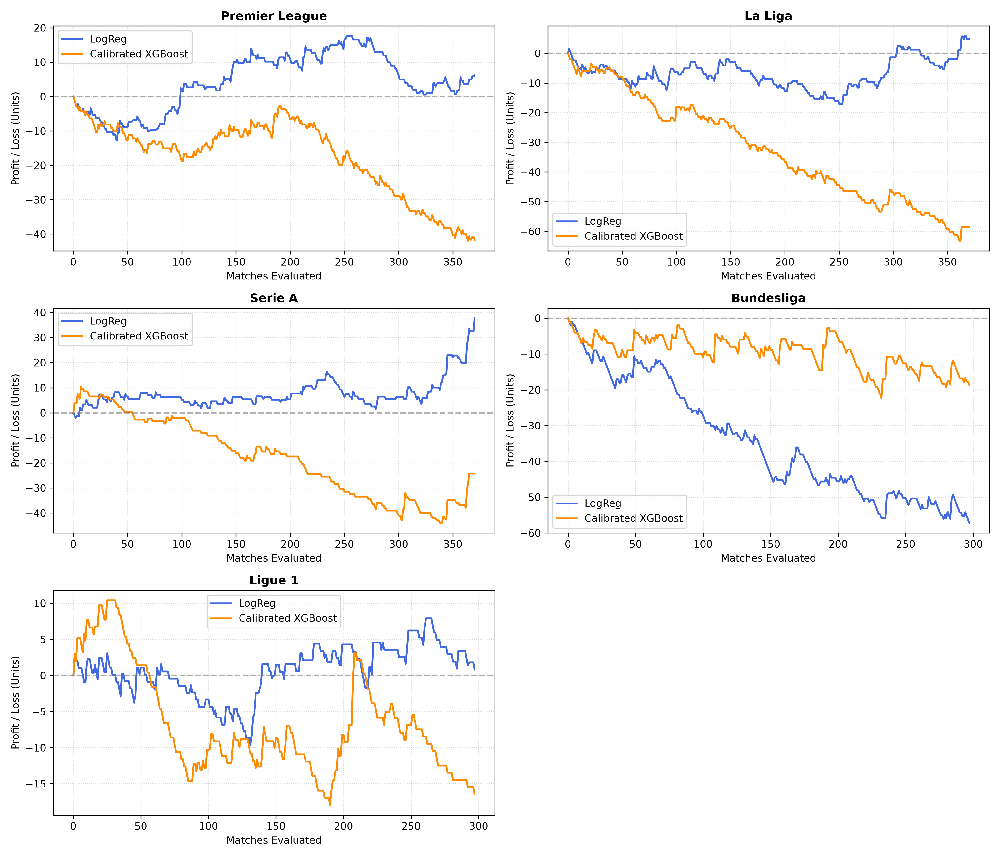
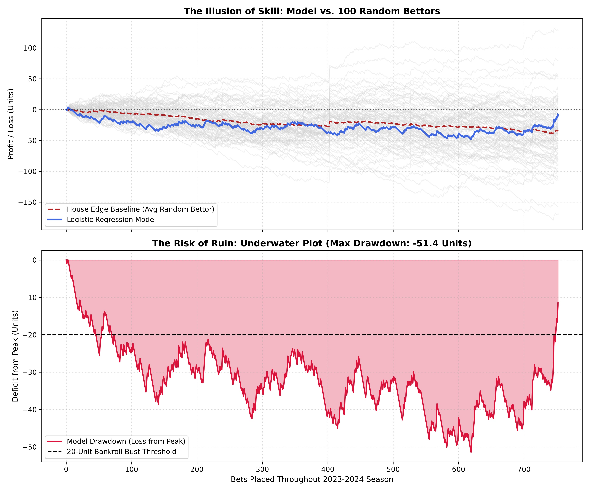

<!-- Improved compatibility of back to top link: See: https://github.com/othneildrew/Best-README-Template/pull/73 -->
<a id="readme-top"></a>

<!-- PROJECT SHIELDS -->
[![Contributors][contributors-shield]][contributors-url]
[![Forks][forks-shield]][forks-url]
[![Stargazers][stars-shield]][stars-url]
[![Issues][issues-shield]][issues-url]
[![MIT License][license-shield]][license-url]
[![LinkedIn][linkedin-shield]][linkedin-url]


<!-- PROJECT LOGO -->
<br />
<div align="center">
  <a href="https://github.com/meh6di/can-you-beat-randomness">
    
  </a>

<h3 align="center">Can You Beat Randomness?</h3>

  <p align="center">
    An academic evaluation of sports market efficiency, machine learning calibration, and the mathematical realities of Gambler's Ruin.
    <br />
    <a href="https://github.com/meh6di/can-you-beat-randomness"><strong>Explore the docs »</strong></a>
    <br />
    <br />
    <a href="https://github.com/meh6di/can-you-beat-randomness/issues/new?title=Bug%3A%20">Report Bug</a>
    &middot;
    <a href="https://github.com/meh6di/can-you-beat-randomness/issues/new?title=Feature%20request%3A%20">Request Feature</a>
  </p>
</div>


<!-- TABLE OF CONTENTS -->
<details>
  <summary>Table of Contents</summary>
  <ol>
    <li>
      <a href="#about-the-project">About The Project</a>
      <ul>
        <li><a href="#core-discoveries">Core Discoveries</a></li>
        <li><a href="#built-with">Built With</a></li>
      </ul>
    </li>
    <li>
      <a href="#data-pipeline--leakage-prevention">Data Pipeline & Leakage Prevention</a>
    </li>
    <li>
      <a href="#backtesting-framework--results">Backtesting Framework & Results</a>
    </li>
    <li>
      <a href="#gambling-risk-analysis">Gambling Risk Analysis</a>
    </li>
    <li>
      <a href="#getting-started">Getting Started</a>
      <ul>
        <li><a href="#prerequisites">Prerequisites</a></li>
        <li><a href="#installation">Installation</a></li>
      </ul>
    </li>
    <li><a href="#usage">Usage</a></li>
    <li><a href="#roadmap">Roadmap</a></li>
    <li><a href="#contributing">Contributing</a></li>
    <li><a href="#license">License</a></li>
    <li><a href="#contact">Contact</a></li>
    <li><a href="#acknowledgments">Acknowledgments</a></li>
  </ol>
</details>


<!-- ABOUT THE PROJECT -->
## About The Project


*You can't watch a match without a betting ad popping up, so I built a model to find out if anyone actually beats market randomness.*

Can algorithmic statistical models consistently exploit inefficiencies in European football betting markets, or does the bookmaker margin guarantee long-term financial decline?

**Can You Beat Randomness?** is an educational, research-driven study analyzing three seasons of match data across Europe's top five football leagues:

* **Premier League** (England)
* **La Liga** (Spain)
* **Serie A** (Italy)
* **Bundesliga** (Germany)
* **Ligue 1** (France)

Rather than acting as a commercial advisory or tipping system, this research systematically benchmarks machine learning algorithms (**Multinomial Logistic Regression**, raw **XGBoost**, and **Platt-Calibrated XGBoost**) against the bookmaker's overround and Monte Carlo baseline agents.

> [!WARNING]
> **Disclaimer:** This project is developed solely for educational, academic, and research purposes in quantitative data analysis and machine learning. It is not financial advice, gambling advice, or an invitation to place bets. I do not operate betting services, handle wagers, or encourage illegal gambling under Moroccan law or any other jurisdiction.

### Core Discoveries

1. **The Overround Gravity Well:** A blind random bettor loses between **-6% and -7% ROI** directly to the bookmaker's pricing cut.
2. **Smooth Probabilities Beat Complex Trees:** Uncalibrated tree models (XGBoost) output step-wise, overconfident predictions that result in severe drawdowns (-6.31% ROI). Multinomial Logistic Regression provides smooth log-odds calibration, resisting market efficiency far more effectively.
3. **The Bundesliga Anomaly:** Out-of-sample regime shifts (such as Bayer Leverkusen's undefeated 2023–2024 season) instantly break models relying on two-year historical distributions, showing how non-stationary sports dynamics penalize rigid statistical assumptions.
4. **The Reality of Gambler's Ruin:** Monte Carlo simulations reveal that even when a model achieves near break-even performance over a full season, prolonged drawdown periods are deep enough to wipe out retail bankrolls.

<p align="right">(<a href="#readme-top">back to top</a>)</p>


### Built With

* [![Python][Python-badge]][Python-url]
* [![Pandas][Pandas-badge]][Pandas-url]
* [![NumPy][NumPy-badge]][NumPy-url]
* [![Scikit-Learn][Scikit-badge]][Scikit-url]
* [![XGBoost][XGBoost-badge]][XGBoost-url]
* [![Matplotlib][Matplotlib-badge]][Matplotlib-url]

<p align="right">(<a href="#readme-top">back to top</a>)</p>


<!-- DATA PIPELINE -->
## Data Pipeline & Leakage Prevention

The data pipeline processes historical fixtures and odds sourced from `football-data.co.uk` using an architecture designed to prevent look-ahead bias and target leakage:

```text
data_raw/ (CSV per League-Season)
  │
  └──> clean_data.py (Filters match events, cards, corners, fouls, and Pinnacle/Avg odds)
        │
        └──> data_clean/
              │
              └──> engineer_features.py (Shifted rolling form, fatigue, conversion, market prob)
                    │
                    └──> data_features/ (Ready for chronological training & evaluation)
```

### Engineered Indicators

* **Overround Normalization:** Bookmaker commissions are stripped out to calculate true market-implied probabilities:
  ```text
  Overround = (1 / AvgH) + (1 / AvgD) + (1 / AvgA)
  Market Probability (Home) = (1 / AvgH) / Overround
  ```
* **Rolling Form Windows:** Shifted 5-game rolling averages (`shift(1)`) are applied to goals scored, goals conceded, shots, shots on target (SoT), fouls, cards, and corners.
* **Efficiency Ratios:** Shot Accuracy (Rolling SoT / Rolling Shots) and Finishing Conversion (Rolling Goals / Rolling SoT).
* **Schedule Congestion:** Rest days calculated as days between matches per club, capped at 14 days to filter summer breaks.
* **Head-to-Head Differentials:** Direct differentials between home and away rolling statistics.

<p align="right">(<a href="#readme-top">back to top</a>)</p>


<!-- BACKTESTING -->
## Backtesting Framework & Results

Models are trained on two historical seasons (**2021–2022** and **2022–2023**) and tested out-of-sample on the **2023–2024** season across all 5 leagues.

### 1. Initial Baseline Backtest (`backtest.py`)

Multi-outcome betting with a low 3% edge buffer:

| Agent | Total Bets | Net Profit (Units) | Aggregate ROI |
| --- | --- | --- | --- |
| **Random Agent** | 1,704 | -117.74 | **-6.91%** |
| **Favorite Agent** | 1,704 | +2.40 | **+0.14%** |
| **Model (LogReg)** | 1,502 | -6.43 | **-0.43%** |

### 2. Advanced Backtest (`backtest_advanced.py`)

Enforcing a **single-bet-per-match constraint** and an increased **6% minimum value threshold**. The XGBoost figures in this table refer to the **uncalibrated model**:

| Competition | LogReg Bets | LogReg ROI | XGBoost Bets | XGBoost ROI |
| --- | --- | --- | --- | --- |
| **Premier League** | 155 | **+4.00%** | 228 | -17.16% |
| **La Liga** | 150 | **+3.18%** | 225 | -6.24% |
| **Serie A** | 126 | **+29.90%** | 188 | -8.13% |
| **Bundesliga** | 203 | -28.17% | 208 | -3.18% |
| **Ligue 1** | 118 | **+0.69%** | 159 | **+7.23%** |
| **Overall (5 Leagues)** | **752** | **-1.03%** | **1,008** | **-6.31%** |

### 3. Probability Calibration Analysis (`deep_analysis.py`)

The project also evaluates probability calibration for XGBoost using Platt scaling (sigmoid calibration). `CalibratedClassifierCV(estimator=xgb_base, method="sigmoid", cv=3)` is fitted using the training data, with the held-out 2023–2024 season reserved for out-of-sample evaluation. This analysis is separate from the advanced-backtest table above, which reports results for raw XGBoost; no calibrated-XGBoost ROI is reported in that table.

### League Equity Curves



<p align="right">(<a href="#readme-top">back to top</a>)</p>


<!-- GAMBLING RISK ANALYSIS -->
## Gambling Risk Analysis

To investigate whether algorithmic profitability is real or an illusion of luck, `plot_gambling_risks.py` simulates the full 2023–2024 European campaign against a **100-Bettor Monte Carlo Chance Cloud** and tracks peak-to-trough drawdowns.



### Critical Findings

* **The Illusion of Skill:** The model's equity trajectory falls inside the 100-bettor Monte Carlo cloud. Periods of upward movement are statistically consistent with ordinary positive variance rather than true market inefficiencies.
* **Drawdown Exceeds Capitalization:** Despite finishing near break-even overall (-1.03%), the model experienced prolonged peak-to-trough drawdowns exceeding **-25 to -30 units**. Under typical bankroll management rules, retail bettors would face total capital wipeout before seeing recovery.

### Conclusion

After the bookmaker's margin, none of the models produced returns distinguishable from luck over the 2023–2024 test season. The strong results in individual leagues (e.g. Serie A) rest on small samples of roughly 120–200 bets and are consistent with ordinary variance. Even near break-even performance carried drawdowns large enough to ruin a typical bankroll, so in this study, modeling skill did not translate into a reliable betting edge.

<p align="right">(<a href="#readme-top">back to top</a>)</p>


<!-- GETTING STARTED -->
## Getting Started

To run the pipeline, reproduce the backtests, or generate the charts locally, follow these steps.

### Prerequisites

* Python 3.9+
* pip

### Installation

1. Clone the repo
   ```sh
   git clone https://github.com/meh6di/can-you-beat-randomness.git
   cd can-you-beat-randomness
   ```
2. Create and activate a virtual environment
   ```sh
   python -m venv .venv
   # Windows:
   .venv\Scripts\activate
   # macOS/Linux:
   source .venv/bin/activate
   ```
3. Install dependencies
   ```sh
   pip install pandas numpy scikit-learn xgboost matplotlib requests
   ```

<p align="right">(<a href="#readme-top">back to top</a>)</p>


<!-- USAGE EXAMPLES -->
## Usage

Run the scripts in sequential order:

1. **Download Data**
   ```sh
   python fetch_data.py
   ```
2. **Clean & Filter Raw Match Data**
   ```sh
   python clean_data.py
   ```
3. **Engineer Rolling Indicators & Fair Odds**
   ```sh
   python engineer_features.py
   ```
4. **Run Benchmark Backtest**
   ```sh
   python backtest.py
   ```
5. **Run Advanced Comparison (LogReg vs XGBoost)**
   ```sh
   python backtest_advanced.py
   ```
6. **Generate Deep Analysis & Calibration Metrics**
   ```sh
   python deep_analysis.py
   ```
7. **Generate Risk of Ruin & Monte Carlo Visualizations**
   ```sh
   python plot_gambling_risks.py
   ```

<p align="right">(<a href="#readme-top">back to top</a>)</p>


<!-- ROADMAP -->
## Roadmap

- [x] Download raw historical match files across top 5 leagues (2021–2024)
- [x] Clean and synchronize column representations
- [x] Feature engineering with shifted rolling form stats and rest intervals
- [x] Benchmark 3-agent backtesting setup
- [x] Integrate XGBoost comparison and single-bet constraint
- [x] Apply Platt scaling (`CalibratedClassifierCV`) on tree models
- [x] Monte Carlo simulations and underwater drawdown risk modeling
- [ ] Incorporate Dixon-Coles Poisson goal expectancy models
- [ ] Implement closing line value (CLV) metric against Pinnacle benchmark odds

See the [open issues](https://github.com/meh6di/can-you-beat-randomness/issues) for a full list of proposed features (and known issues).

<p align="right">(<a href="#readme-top">back to top</a>)</p>


<!-- CONTRIBUTING -->
## Contributing

Contributions are what make the open source community such an amazing place to learn, inspire, and create. Any contributions you make are **greatly appreciated**.

If you have a suggestion that would make this better, please fork the repo and create a pull request. You can also simply open an issue with the tag "enhancement".
Don't forget to give the project a star! Thanks again!

1. Fork the Project
2. Create your Feature Branch (`git checkout -b feature/AmazingFeature`)
3. Commit your Changes (`git commit -m 'Add some AmazingFeature'`)
4. Push to the Branch (`git push origin feature/AmazingFeature`)
5. Open a Pull Request

<p align="right">(<a href="#readme-top">back to top</a>)</p>

### Top contributors:

<a href="https://github.com/meh6di/can-you-beat-randomness/graphs/contributors">
  
</a>


<!-- LICENSE -->
## License

Distributed under the MIT License. See `LICENSE.txt` for more information.

<p align="right">(<a href="#readme-top">back to top</a>)</p>


<!-- CONTACT -->
## Contact

Mohamed El Mehdi El Allaoui - mohamedelmehdi.elallaoui@centrale-casablanca.ma

Project Link: [https://github.com/meh6di/can-you-beat-randomness](https://github.com/meh6di/can-you-beat-randomness)

<p align="right">(<a href="#readme-top">back to top</a>)</p>


<!-- ACKNOWLEDGMENTS -->
## Acknowledgments

* [Football-Data.co.uk](https://www.football-data.co.uk/) for maintaining open historical football match and odds datasets
* [Scikit-Learn Documentation](https://scikit-learn.org/) for probability calibration and logistic regression modules
* [Best-README-Template](https://github.com/othneildrew/Best-README-Template) for the documentation scaffold

<p align="right">(<a href="#readme-top">back to top</a>)</p>


<!-- MARKDOWN LINKS & IMAGES -->
<!-- https://www.markdownguide.org/basic-syntax/#reference-style-links -->
[contributors-shield]: https://img.shields.io/github/contributors/meh6di/can-you-beat-randomness.svg?style=for-the-badge
[contributors-url]: https://github.com/meh6di/can-you-beat-randomness/graphs/contributors
[forks-shield]: https://img.shields.io/github/forks/meh6di/can-you-beat-randomness.svg?style=for-the-badge
[forks-url]: https://github.com/meh6di/can-you-beat-randomness/network/members
[stars-shield]: https://img.shields.io/github/stars/meh6di/can-you-beat-randomness.svg?style=for-the-badge
[stars-url]: https://github.com/meh6di/can-you-beat-randomness/stargazers
[issues-shield]: https://img.shields.io/github/issues/meh6di/can-you-beat-randomness.svg?style=for-the-badge
[issues-url]: https://github.com/meh6di/can-you-beat-randomness/issues
[license-shield]: https://img.shields.io/github/license/meh6di/can-you-beat-randomness.svg?style=for-the-badge
[license-url]: https://github.com/meh6di/can-you-beat-randomness/blob/master/LICENSE.txt
[linkedin-shield]: https://img.shields.io/badge/-LinkedIn-black.svg?style=for-the-badge&logo=linkedin&colorB=555
[linkedin-url]: https://linkedin.com/in/mehdi-el-allaoui-24b6b5291
[product-screenshot]: images/screenshot.png
<!-- Shields.io badges. Find more badge options at: https://github.com/inttter/md-badges -->
[Python-badge]: https://img.shields.io/badge/Python-3776AB?style=for-the-badge&logo=python&logoColor=white
[Python-url]: https://www.python.org/
[Pandas-badge]: https://img.shields.io/badge/Pandas-150458?style=for-the-badge&logo=pandas&logoColor=white
[Pandas-url]: https://pandas.pydata.org/
[NumPy-badge]: https://img.shields.io/badge/NumPy-013243?style=for-the-badge&logo=numpy&logoColor=white
[NumPy-url]: https://numpy.org/
[Scikit-badge]: https://img.shields.io/badge/scikit--learn-F7931E?style=for-the-badge&logo=scikitlearn&logoColor=white
[Scikit-url]: https://scikit-learn.org/
[XGBoost-badge]: https://img.shields.io/badge/XGBoost-EC6B23?style=for-the-badge&logo=xgboost&logoColor=white
[XGBoost-url]: https://xgboost.ai/
[Matplotlib-badge]: https://img.shields.io/badge/Matplotlib-11557C?style=for-the-badge&logo=matplotlib&logoColor=white
[Matplotlib-url]: https://matplotlib.org/
